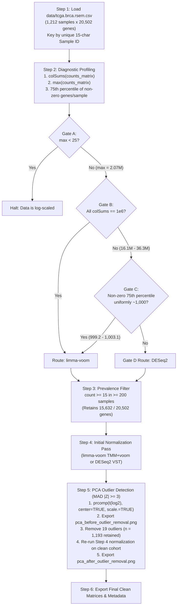

# Adaptive RNA-Seq Diagnostic, QC, Filtering, Normalization & Outlier Detection Plan

## Overview
Build and execute `src/normalize_rnaseq.R` to programmatically diagnose the scaling state of `data/tcga.brca.rsem.csv`, filter low-prevalence genes, route the dataset to the statistically appropriate normalization framework (`limma-voom` vs. `DESeq2`), screen and remove sample outliers via PCA robust Z-scores (`MAD |Z| >= 3`), and re-normalize the clean cohort.

---

## Diagnostic Profiling & Framework Suitability

### 1. Diagnostic Metrics (What We Are Looking For)
- **Sample Column Sums (`colSums`):** Tests whether per-sample total abundance varies naturally with sequencing library depth (tens of millions) or sums to a constant `1,000,000` (`1e6`), which indicates prior TPM/CPM scaling.
- **Matrix Maximum Value (`max`):** Distinguishes linear-scale abundance (`> 10^4`–`10^6`) from pre-applied logarithmic transformations (`max < 25` on a $\log_2$ scale), which cannot be fed into count-based normalization pipelines.
- **75th Percentile of Non-Zero Genes (`q75_nonzero`):** Detects Upper-Quartile (UQ) scaling; whereas raw RSEM expected counts show dynamic 75th percentiles across samples, TCGA Level 3 UQ-normalized RSEM data fixes every sample's non-zero 75th percentile at `~1,000` (`999.2`–`1,003.1`, CV = `0.045%`).

### 2. Suitability: `limma-voom` / `edgeR` vs. `DESeq2`
- **Why `DESeq2` Requires Unscaled Counts (Gate D):** `DESeq2` models un-normalized integer counts using a Negative Binomial distribution where the mean-variance relationship and median-of-ratios size factors depend on raw sequencing depth; applying it to pre-scaled data (TPM/CPM or Upper-Quartile RSEM) distorts dispersion estimation.
- **Why `limma-voom` + `edgeR` (TMM) Fits Pre-Scaled Linear Data (Gates B & C):** Because `data/tcga.brca.rsem.csv` is already Upper-Quartile scaled (Gate C), `edgeR::calcNormFactors(method = "TMM")` corrects residual sample-specific compositional bias on the linear scale, and `limma::voom` non-parametrically models the empirical mean-variance trend on $\log_2$-CPM values without requiring raw integer counts.

### 3. PCA Sample Outlier Detection (`MAD |Z| >= 3` with `scale. = TRUE`)
- **Why `scale. = TRUE` in `prcomp`:** In unscaled PCA (`scale. = FALSE`), `PC2` is dominated by hyper-variable lineage genes (`r = 0.80` with `ESR1`), causing the tight ER+ Luminal majority (~80% of breast tumors) to shrink `mad(PC2)` and falsely flag 145 Basal-like/ER-negative tumors (`|Z_PC2| >= 3`). Using unit-variance scaling (`scale. = TRUE`) weights all 15,632 genes equally so `PC1` and `PC2` capture global sample-level technical variation, isolating 19 genuine extreme technical outliers while preserving biological subtypes.

---

## Execution Steps

1. **Execute `src/normalize_rnaseq.R`:**
   - **Step 1 (Data Parsing & Matrix Separation):** Uses the 15-character `sample_id` (`substr(bcr_patient_barcode, 1, 15)`, e.g., `TCGA-3C-AAAU-01`) as the unique sample identifier (`1,212` samples × `20,502` genes).
   - **Step 2 (Diagnostic Logic Gates):** Evaluates Gates A–D using sample column sums, matrix max value, and the 75th percentile of non-zero genes (`all(q75_nonzero >= 995 & q75_nonzero <= 1005) && q75_cv < 0.01`).
   - **Step 3 (Prevalence Filtering):** Retains genes with expression `>= 15` in `>= 200` samples (`15,632` / `20,502` genes, including `ERBB2`).
   - **Step 4 (Initial Normalization):** Runs initial `edgeR` TMM + `limma::voom` normalization on all `1,212` samples.
   - **Step 5 (PCA Outlier Screening & Re-Normalization):** Flags samples with robust Z-score `|Z| = |PC_i - median(PC_i)| / mad(PC_i) >= 3` on `PC1` or `PC2` (`19` outliers), saves `results/pca_before_outlier_removal.png` and `results/pca_outliers_removed.csv`, removes the 19 outliers (`1,193` samples retained), re-runs Step 4 normalization on the clean subset, and saves `results/pca_after_outlier_removal.png`.
   - **Step 6 (Output Export):** Exports `results/rsem_sample_metadata.csv` (`1,193` samples), `results/matrix_normalized_linear.csv` (`15,632 × 1,193`), and `results/matrix_normalized_log2_stabilized.csv` (`15,632 × 1,193`).
2. **Verify Outputs & Update Report:**
   - Verify output dimensions and `ERBB2` distribution, and document findings and PCA visualizations in `results/her2_profiling_report.md`.
